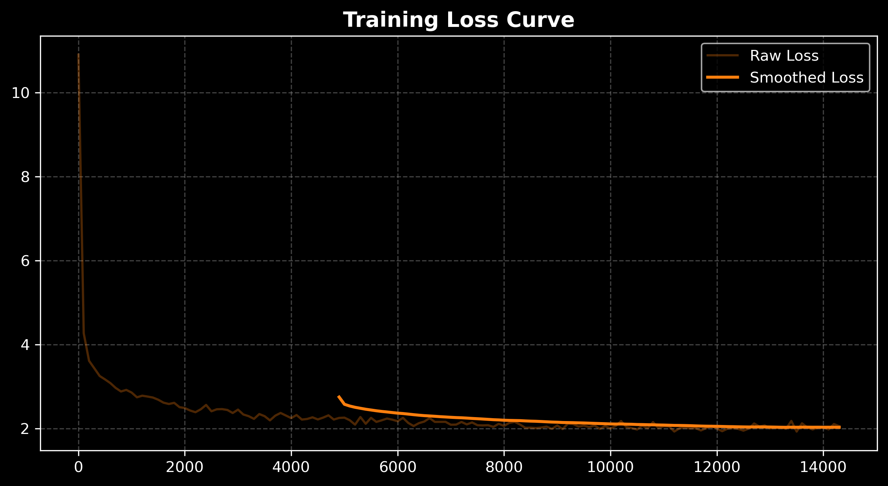
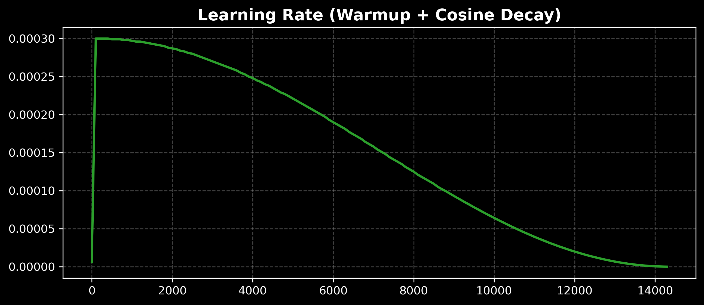
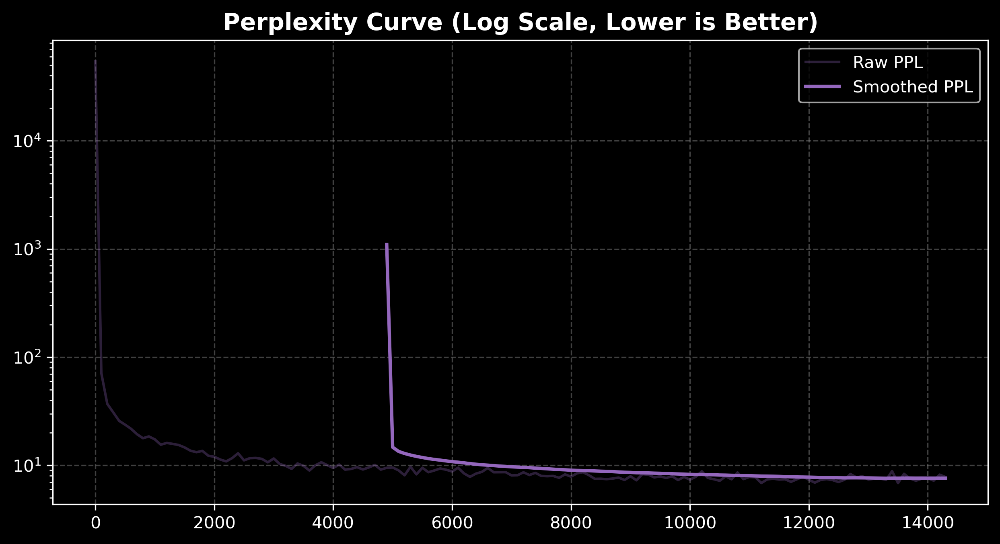
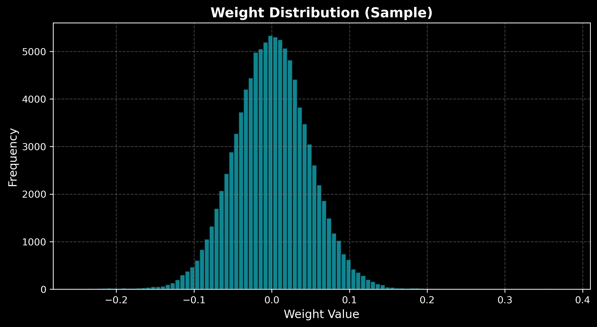
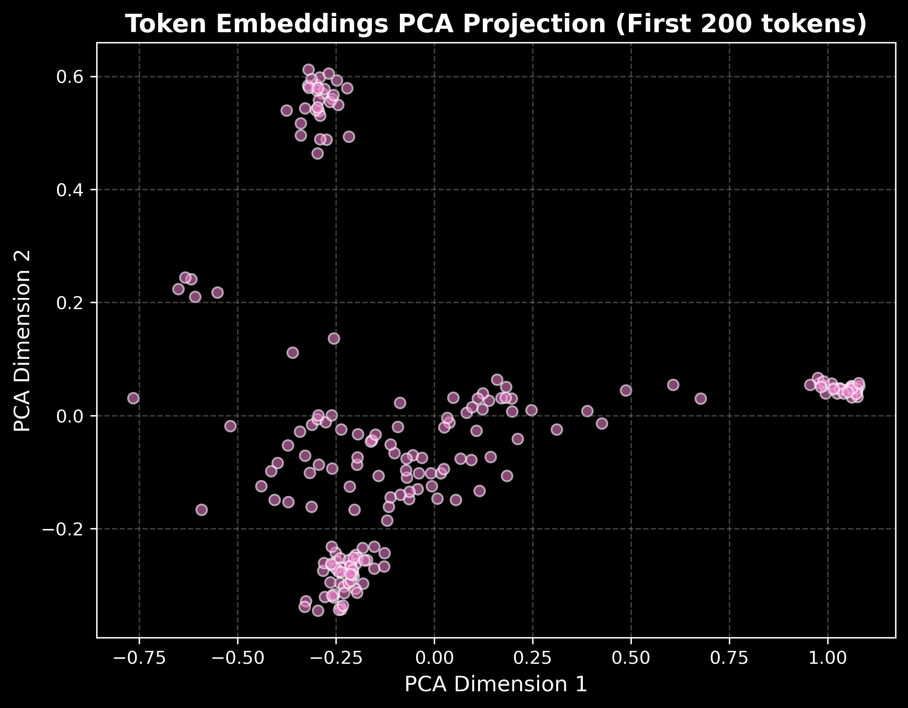
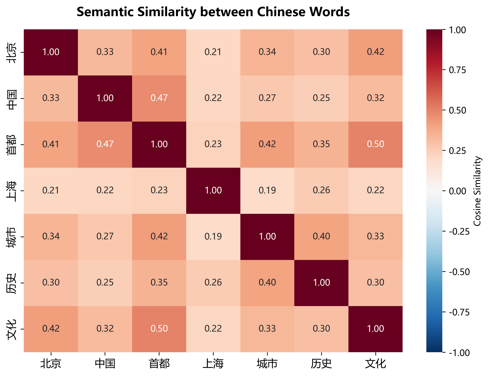
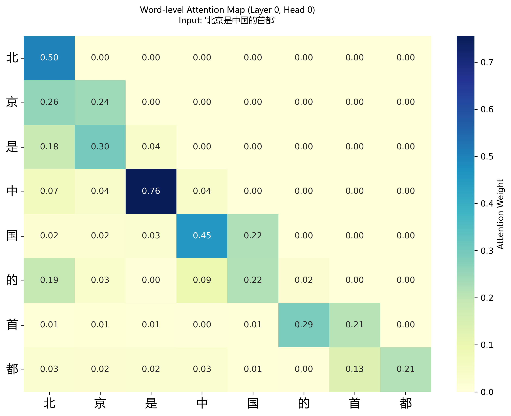

# gpt-mini (Chinese Edition)

A minimal GPT-2 style language model written from scratch.
**面向中文语料的基于GPT-2架构大语言模型**

本项目通过 PyTorch 代码实现了一个大体基于 GPT-2 架构的小型语言模型（SLM），旨在帮助学习者深入理解 Transformer 的内部机制（因果自注意力、Pre-LN 残差结构、词嵌入共享等）以及完整的训练闭环：从中文文本读取、BPE 分词、切块、Next-token 预测到模型权重的保存与推理。

> **⚠️ 声明**：这是一个**教学基线项目 (Learning Baseline)**，并非生产可用的大模型。它可以帮助你跑通原理，但受限于数据量（默认仅 1000 行中文语料），模型极易过拟合，无法生成具有逻辑的长文本。

## ✨ 核心特性 (Features)

- **Pre-LN Transformer Blocks**: 采用现代大模型广泛使用的预归一化残差架构。
- **Multi-Head Causal Self-Attention**: 将多头注意力拆解为 `n_head` 个独立的单头注意力组合，代码可读性极高。
- **Weight Tying**: 输入 Token Embedding 与输出 LM Head 共享权重，大幅减少参数量。
- **中文数据 Pipeline**: 提供从中文 JSONL 语料到 `tiktoken` 分词、定长切块的完整数据处理流。
- **Reproducible**: 固定了全局随机种子，保证训练过程可复现。

## 📁 项目结构 (Project Structure)

```text
gpt-mini/
├── config.py        # GPTConfig (模型架构的超参数)
├── model.py         # 核心网络结构 (Attention / FFN / Block / GPT)
├── dataset.py       # 数据处理类 (JSONL -> Token 流 -> 定长切块)
├── train.py         # 完整的训练循环、验证评估与 Checkpoint 保存
├── generate.py      # 加载权重，输入中文 Prompt 进行文本生成
├── utils.py         # 通用工具 (set_seed / get_device 等)
├── requirements.txt # 依赖项
├── data/            # 存放训练数据 (不提交至 Git)
└── checkpoints/     # 存放训练输出的模型权重 (不提交至 Git)
```

## 🛠️ 环境准备 (Setup)

```bash
# 安装依赖
pip install -r requirements.txt

# 预热分词器 (首次运行 tiktoken 会下载约 1MB 的 GPT-2 BPE 词表)
python -c "import tiktoken; tiktoken.get_encoding('gpt2')"
```

## 📚 中文数据集 (Data)

本项目期待的数据格式为 JSONL（每行一个 JSON 对象，包含 text 字段）：

```json
{"id": "1", "text": "今天天气很好，我们一起去公园散步。"}
```

这里使用的数据源：中文维基百科
推荐使用 HuggingFace 上的 rfikd/wikipedia-zh-cn 数据集。

由于完整数据集高达 2.1GB，而我们仅需要验证代码跑通，建议在本地截取前 1000 行，再上传到云服务器，节省传输时间：

```bash
# 截取前 1000 行 (仅几 MB)
head -n 1000 wikipedia-zh-cn-20240901.json > data/wiki_1000.jsonl
```

## 🚀 训练指南 (Train)

### 第 1 步：冒烟测试 (Smoke Test)
在消耗大量算力前，可以先用极小的模型配置和数据跑通流程：

```bash
python train.py \
  --data_path data/wiki_1000.jsonl \
  --max_lines 100 \
  --block_size 64 \
  --batch_size 4 \
  --n_layer 2 --n_head 2 --n_embd 128 \
  --epochs 1 \
  --out_dir checkpoints_smoke
```

如果终端成功打印 loss 并在 checkpoints_smoke/ 下生成了 .pt 文件，说明环境没问题。
预期输出示例：

```text
Device: cpu
Chunks: total=21522, train=19370, val=2152
Parameters: 6.84M
[epoch 0] step    0/4843 loss=10.8378 lr=6.00e-06
[epoch 0] step  100/4843 loss=6.8965 lr=3.00e-04
[epoch 0] step  200/4843 loss=5.1409 lr=3.00e-04
...
== epoch 0 | train=3.52 | val=3.48 | 340.5s
Saved checkpoints_smoke/model_epoch_0.pt
```

### 第 2 步：正式训练 (Real Training)
使用完整的 1000 行数据进行训练（可根据显存调整 batch_size）：

```bash
python train.py \
  --data_path data/wiki_1000.jsonl \
  --max_lines 1000 \
  --block_size 512 \
  --batch_size 12 \
  --n_layer 6 --n_head 6 --n_embd 384 \
  --epochs 2 \
  --lr 3e-4 \
  --out_dir checkpoints
```

训练完成后，checkpoints/ 目录下会生成每个 Epoch 的权重以及验证集 Loss 最低的 best.pt。

## 💬 生成测试 (Generate)

使用训练好的模型进行中文文本续写：

```bash
python generate.py \
  --ckpt checkpoints/best.pt \
  --prompt "人工智能是" \
  --max_new_tokens 100
```
(提示：由于训练数据极少，模型生成的内容可能会重复或缺乏连贯逻辑，这属于正常现象。)

## 😅 模型局限性与有趣案例 (Limitations & Funny Cases)

我用前文提及的数据集（HuggingFace 上的 rfikd/wikipedia-zh-cn 数据集）进行训练，
从 10 万行中文维基百科语料中截取了**前 3 万行**进行训练（约 51 万个数据块，总计 14,365 个 Step）
参数如下：

```bash
python train.py --data_path data/wiki_100k.jsonl --max_lines 30000 --block_size 256 --batch_size 32 --n_layer 6 --n_head 6 --n_embd 384 --epochs 1 --lr 3e-4 --weight_decay 0.1 --dropout 0.1 --out_dir checkpoints_100k
```

RTX4090运行30min左右
因为终归是轻量实现，所以我试了一下对话，只能保证符合语法，但大多回答像在写散文诗或说胡话😄

以下是一些真实的零样本 (Zero-shot) 生成测试案例，供大家一乐：

*   **输入**: `人工智能是一种`  
    **输出**: `人工智能是一种最干燥的热带气候变化和质量，因此当地的油调类似于热带`
*   **输入**: `黑洞是宇宙中`  
    **输出**: `黑洞是宇宙中最著名的城市，但是在其他地区的城市则则是城市。城市的建筑`
*   **输入**: `莎士比亚是英国`  
    **输出**: `莎士比亚是英国最大的城市，非洲国家重视的战争，这时期的战后亦经济发展出`
*   **输入**: `今天早上我吃了一个`  
    **输出**: `今天早上我吃了一个月的政治和人的制度，允许在我这些制度上发行。同时还指出，他`
*   **输入**: `这只猫非常喜欢吃`  
    **输出**: `这只猫非常喜欢吃的角色。不过，一般经常采访前回多年的污染，该经过轻调`

其实不难看出，模型虽然掌握了基础的中文语法和词频规律，但由于缺乏日常对话和常识语料，表现出了极强的**“维基百科领域偏置”**（满嘴都是城市、政治、地理）。

> **工程反思**：
> 如果想解决这种“胡说八道”，在工业界通常需要两步：
> 1. **扩大模型参数量**（如 1B 以上）以容纳常识知识。
> 2. **引入 SFT (指令微调)** 或对话语料，让模型从“续写维基百科”转变为“回答问题”。

## 📊 训练指标与可视化 (Training & Visualizations)

本项目不仅从零手写了 GPT-2 架构，还集成了工业级的训练监控与深度模型剖析图表，全方位验证了模型的有效性。
使用best_model_100k.pt里的参数

### 1. 训练核心指标 (Training Metrics)

模型从 10 万行中文维基百科语料中截取了**前 3 万行**进行训练（约 51 万个数据块，总计 14,365 个 Step）。以下指标展示了模型极其健康且稳定的收敛过程：

*   **训练损失 (Loss)**：从初始的 10.9 稳步下降至 1.93，曲线平滑无异常尖峰。
*   **学习率调度 (LR)**：采用了工业界标准的 Warmup（预热）与 Cosine Decay（余弦退火）策略，保证训练前期的稳定性与后期的精细调优。
*   **困惑度 (Perplexity)**：作为大模型核心评估指标，PPL 呈指数级下降（对数坐标下呈直线），证明模型的预测自信度与准确度大幅跃升。

<p align="center">
  
  
</p>
<p align="center">
  
</p>

### 2. 模型内部机理剖析 (Model Internals)

为了验证模型真正学到了语义和语法，而不仅仅是死记硬背，我们提取了训练后的权重与 Embedding 进行降维和统计分析。

*   **权重分布 (Weight Distribution)**：各层参数呈现完美的钟形正态分布，说明模型没有发生梯度爆炸或坍塌，训练极其健康。
*   **词向量降维 (Embedding PCA)**：将 384 维的词向量投影到 2D 空间，可以看到模型自发地将语义相近的 Token 聚拢在一起，形成了明显的“语义聚类簇”。

<p align="center">
  
  
</p>

*   **中文语义相似度 (Semantic Similarity)**：提取特定高频词计算余弦相似度。可以看到“北京”与“首都”、“中国”与“城市”等极具现实关联的词，在模型内部向量空间中距离极近。这证明手写架构成功从统计学规律中学习到了中文的分布式语义表示。

<p align="center">
  
</p>

### 3. 注意力机制可视化 (Word-level Attention Map)

*(注：由于 GPT-2 的 BPE 分词器会将中文字符切碎为不可见的单字节，我们在可视化时专门实现了**字级别的注意力聚合 (Word-level Aggregation)** 算法，以提供最符合人类阅读习惯的语义视图。)*

这是模型第一层（Layer 0, Head 0）在处理句子 **"北京是中国的首都"** 时的注意力分配热力图：



**深度解读：**
1.  **因果掩码 (Causal Mask)**：右上角呈纯色 0，说明模型严格遵守了自回归特性，当前词无法“看到”未来的词。
2.  **注意力下沉 (Attention Sink)**：观察前两行（“北”和“京”），模型将极高的权重分配给了句首 token 本身。这是 Transformer 架构中非常经典的“注意力垃圾桶”现象。
3.  **局部语法关联**：在处理“中”字时，模型分配了极高的权重（0.76）给前一个词“是”，说明在早期层中，模型高度关注相邻的局部语法依赖关系，成功学会了中文的断句逻辑。

---
*(以上图表均由项目内的 `plot_*.py` 脚本全自动生成，保证实验结果 100% 可复现)*

## ⚠️ 注意事项 (Caveats)

**过拟合 (Overfitting)**：1000 行中文数据产生的 Token 数远不足以喂饱 120M 参数量的模型。训练 Loss 会显著下降，但验证 Loss 可能会反弹。这主要是为了跑通教学流程。

**无 KV Cache**：generate.py 每次推理都会重新计算完整上下文。适合短文本生成，长文本推理较慢。

**分词效率**：项目使用 GPT-2 BPE 分词器，它对中文的切分粒度较细（一个汉字会被切为多个 Byte-level Token）。在真实中文大模型中，通常会使用针对中文优化的 Sentence Piece 或扩充词表。

## 📄 License
MIT License
